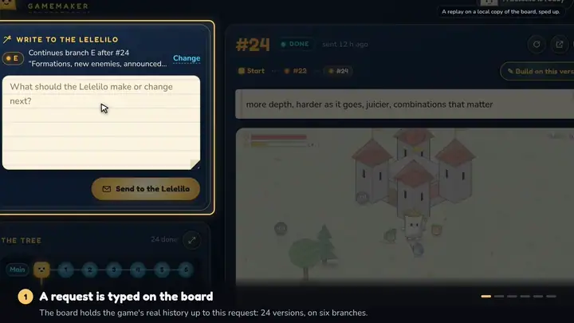

# Lelelilo Gamemaker

My brother types what he wants in a game on a web page. A watcher on my own machine picks the request up, runs
Claude Code on the game's source inside an OS sandbox, builds and tests the result, publishes the playable build
to GitHub Pages and reports back to the page.

## Demo

[](docs/demo.mp4?raw=true)

A tour of one request, from the board to a playable version. The picture is a short preview: click it for the
full video with captions (MP4, 9 MB; GitHub hands it over as a download).

## How it works

```
  brother's browser            the VPS                                the agent's machine
        │                 ┌───────────────────────────┐          ┌──────────────────────────────────┐
        │ 1. a prompt     │ Caddy                     │ 2. asks, │ systemd timer, every 30 s        │
        ├────────────────▶│   allowed IPs only        │◀─────────┤   watch.py run                   │
        │    (HTTPS)      │   login (basic auth)      │  claims, │        │                         │
        │                 │        │ X-Gamemaker-User │  notes,  │        ▼ 3.                      │
        │                 │        ▼                  │  result  │   claude -p, fenced in:          │
        │                 │ server.py on 127.0.0.1    │          │   changes the game, builds it,   │
        │                 │ SQLite in var/            │          │   tests it in a browser, commits │
        │                 └───────────────────────────┘          │        │                         │
        │                                                        │        ▼ 4.                      │
        │ 5. the page shows the result, in a frame               │   watch.py: checks the result    │
        ▼                                                        └────────┬─────────────────────────┘
  GitHub Pages ◀──────────────────── git push (the built site only) ──────┘
    /            the newest build
    /v/<id>/     every version, frozen (v/0/ is the game before the first prompt)
```

- **The board** (`VPS/`) is `server.py`, plain Python with nothing to install, and one SQLite file. (Notifications
  need the `cryptography` package, and are off without it.) It listens on 127.0.0.1 only. Caddy stands in front:
  it lets in the allowed IPs, asks for a login, and passes the login's name on in `X-Gamemaker-User`.
- **The watcher** (`VPS/agent/watch.py`) runs on the agent's machine, started every 30 seconds by a systemd user
  timer. If nothing is waiting it exits, and Claude is not started. If a prompt is waiting it claims it and starts
  Claude Code headless (`claude -p`) in the game's source, fenced in, with a brief built around the prompt.
- **Claude** changes the game, builds it, tests it and commits. Its progress notes go into a file, and the watcher
  posts them on the board.
- **The watcher again**: it checks what the run left, pushes the built site (the source stays on the machine),
  waits until GitHub Pages serves the page and marks the prompt done. The board shows the result in a frame next
  to the prompt. A run that failed or was refused is undone, and the board says why.
- **Versions.** The site's root always holds the newest build. Every result is also frozen in `v/<id>/`, and the
  game as it was before the first prompt in `v/0/`. So every version stays playable.
- **Branches.** A prompt builds on the newest version unless told otherwise. "Build on this version", on an older
  one, starts a branch (B, C, ...). Each branch is a git branch in the source, and each version's source is a git
  ref (`refs/gamemaker/v/<id>`), so a new branch starts from the right code.

The game my own install works on is public: [lelelilo-world-web](https://lelelilo-studios.github.io/lelelilo-world-web/)
(its starting point is at [`v/0/`](https://lelelilo-studios.github.io/lelelilo-world-web/v/0/)).

What is public is the compiled build, not the source. The game is written in Rust with wgpu and compiled to
WebAssembly, and it draws with WebGPU in the browser. The
[repository behind that page](https://github.com/lelelilo-studios/lelelilo-world-web) holds, for each version, the
page, the `.wasm` file and the script that loads it. GitHub Pages serves those files, and the board shows the page in
a frame. The game's source is in no public repository.

### How this repo is organised

Two machines take part, and each has its folder.

| Folder | What it is |
|---|---|
| [`VPS/`](VPS/) | The board: `server.py` (the API and the page), `push.py` (notifications), `web/` (the page), `agent/watch.py` (the watcher, which the board serves to the agent's machine), `agent/SETUP.md`, `deploy/`, `tests/`, `try-local.py`. See [`VPS/README.md`](VPS/README.md). |
| [`MY_MACHINE/`](MY_MACHINE/) | The agent's machine, as it is set up at my place: the systemd units, the settings without their secrets, the test scripts that run outside the sandbox, a sample of the check's output. See [`MY_MACHINE/README.md`](MY_MACHINE/README.md). |
| [`docs/`](docs/) | [`AGENT_SETUP.md`](docs/AGENT_SETUP.md): how to set it up on your own machines. |

Secrets and state never go in git: passwords, the watcher's settings file (`~/.config/gamemaker/env`), the push key
(`var/vapid.pem`), databases, logs. `.gitignore` catches the usual names. The game's source is not here either:
only its builds are published.

## The fence

The prompts come from a web page. So every run is fenced in, whatever the prompt says. All of it is in
[`VPS/agent/watch.py`](VPS/agent/watch.py): `claude_cmd()` builds the command line and `settings()` the settings
Claude Code gets. This is what limits a run.

| | How |
|---|---|
| **Restricted mode** | `--restricted`. Claude Code ignores the user, project and local settings files, keeps the file tools to the working directories, and refuses `bypassPermissions`. |
| **Six tools** | `--tools Bash,Read,Edit,Write,Glob,Grep`. No web tools: `WebFetch` and `WebSearch` are on the deny list as well. |
| **No MCP, no hooks** | `--disallowedTools mcp__*` and `--strict-mcp-config` (with no MCP config given), and `"disableAllHooks": true`. |
| **Nobody to ask** | `--permission-mode acceptEdits` with `--permission-prompts none`: anything that would ask for permission is denied. `"disableBypassPermissionsMode": "disable"`. |
| **The sandbox** | Every shell command runs in Claude Code's sandbox, which on Linux is bubblewrap: `"enabled": true`, `"failIfUnavailable": true`, `"allowUnsandboxedCommands": false`. With these, Claude Code is told to fail when the sandbox can't start, and never to retry a command outside it. Two things are outside the sandbox on purpose, and both are set in the watcher's settings on the agent's machine: a script listed in `OUTSIDE_SANDBOX` (`excludedCommands`), and everything when `SANDBOX=off`. See [What this does not protect against](#what-this-does-not-protect-against). |
| **Where it can write** | The two working copies (the game's source, `WORK_DIR`, and the clone of the site, `SITE_DIR`), the run's own temporary folder (its notes and its result) and the one Claude Code gives its commands, and what `SANDBOX_WRITE` names: by default cargo's package caches, `~/.cargo/registry` and `~/.cargo/git`. |
| **What it can read** | Not the rest of the home folder (`"blockReadsOutsideWorkingDirectories": true`), except what `SANDBOX_READ` names: by default `~/.cargo` and `~/.rustup`. |
| **Credentials** | A deny-read list on top: `~/.cargo/credentials`, `~/.cargo/credentials.toml`, `~/.ssh`, `~/.config/gh`, `~/.git-credentials`, `~/.claude/.credentials.json`. |
| **The network** | An allowlist, `"strictAllowlist": true`. By default it is the Rust package hosts and nothing else: `crates.io`, `index.crates.io`, `static.crates.io`, `static.rust-lang.org`. Not GitHub, and not the board. |
| **A time limit** | `RUN_TIMEOUT`, 7200 seconds (2 hours) by default. The watcher enforces this one itself (`run_claude()`): when the time is up it ends Claude's process group (`SIGTERM`, and `SIGKILL` if it is still there 30 seconds later), stops whatever else the run left running, puts the working copies back and marks the prompt failed. |
| **A cost cap, Claude Code's** | `MAX_COST`, in dollars at API prices. The default is 10, and `0` means no cap. The watcher only passes the number on as `--max-budget-usd`, and knows Claude Code's answer when the cap ended a run (`error_max_budget_usd`): the prompt is then marked failed, with that reason. Claude Code does the counting and the stopping, against its own estimate of the cost, and [its documentation](https://code.claude.com/docs/en/cli-reference) says that spend can pass the cap. So a run can end somewhat past it: it is a limit, not a guarantee. My own machine runs with `0` and relies on the time limit. |
| **Claude cannot push** | Its commands have no way to GitHub and cannot read the keys. The watcher pushes, outside the sandbox, and only the site. First it checks that no source files went into the site (`SITE_FORBIDDEN`, by file name). |
| **The board's password** | The watcher reads it from the settings file in the home folder, which a run cannot read (the check tries it), and takes it out of the run's environment. Claude never talks to the board. The settings file is not the only place that holds the password: see [What this does not protect against](#what-this-does-not-protect-against). |
| **Rules** | A system prompt (`--append-system-prompt`, so not a file a run could change) keeps the work on this one game and tells Claude to refuse anything else. A run starts only when both working copies have nothing uncommitted, and a failed or refused run is reset to where it started. |
| **Git's setup is put back** | The watcher's own git runs outside the sandbox. So a run cannot write either working copy's `.git/config` or `.git/hooks` (`denyWrite`, and `Edit(...)` deny rules). What a run left running is stopped. Then each working copy's git setup (`config`, `hooks`, `remotes`, `branches`) is put back byte for byte as it was before the run, without running git, and any repository nested inside is removed. A run that changed any of it fails, and nothing is published. |
| **The check** | `watch.py check` starts Claude exactly as a run does and has it try the fence for real: a write in the home folder, a read of the board's password, a change to each working copy's git settings and hooks. It judges by what is on the disk afterwards, not by what Claude says. [`MY_MACHINE/watch-check.txt`](MY_MACHINE/watch-check.txt) is a sample of its output, with a note at the top on how to read it. With `SANDBOX=off` the check says FIX and does not try the fence. |

The flags are Claude Code's. The watcher needs Claude Code 2.1.259 or later, and `check` says so if it is older.

### What went wrong, and what it taught

Two ways out of the fence were found on 2026-10-08, and patched the same day. Neither broke the sandbox. Both
went around it, through git.

The watcher runs git in the two working copies itself, outside the sandbox: to commit what is left, to push, to
put a failed run back. And git runs programs that a repository names: its hooks, settings such as
`core.fsmonitor` or `core.sshCommand`, and the same of any repository nested inside it. A run can write in the
working copies. So a run could leave something behind that the watcher's own git would start later, outside the
fence, with my rights.

1. **The site's git setup was not guarded.** Claude Code guards `.git/config` and `.git/hooks` in the working
   directory. The site's working copy is a second folder, and there a run could write both.
2. **A repository inside a working copy.** A run could add one in either folder, with settings of its own, and
   git reads those when it goes in.

The fix is in layers, and the last one does not depend on the first:

- Runs are denied those writes in both working copies, in the sandbox and in the file tools.
- When Claude exits, whatever it left running is stopped, so nothing changes the folders behind the watcher's back.
- Before the watcher's git touches a working copy again, its git setup is put back byte for byte from a note
  taken before the run, without running git, and nested repositories are taken out. A run that changed any of
  it fails. If it can't be put back, no git runs there until a person has looked.
- The watcher's own git runs no hooks (`core.hooksPath=/dev/null`), is told exactly where its repository is, and
  ignores replace refs.

What it taught me:

- The weak spot was not in the sandbox. It was where work done inside the sandbox is handed to a tool that runs
  outside it. A tool outside the fence that acts on files written inside is part of the fence.
- One layer is not enough. The tests run a stand-in for Claude with no sandbox at all. One shows that plain git
  really does start what was planted. Another shows that the watcher fails that run, publishes nothing and starts
  none of it.
- A check has to try the real thing. `watch.py check` does the writes and looks at the disk. And after every
  update of the watcher the rule is: read what changed, run the check, and try a tampering run on throwaway
  repositories before the timer starts again.

### What this does not protect against

- **The model's provider sees the code and the prompts.** A run is `claude -p`. What Claude reads of the source
  goes to Anthropic, like every prompt.
- **The rules are instructions, not a wall.** If a prompt talks Claude out of them, what still holds is the
  sandbox and the watcher's checks. Inside the fence a run can do anything to the game. Whoever has a login to the
  page can change what gets published, and the only check on that is by file name, not by content.
- **What a run can read, it could send to an allowed host.** The allowlist is by host name. A run can read the
  two working copies and what `SANDBOX_READ` names. And what it downloads from those hosts it can run, inside
  the sandbox.
- **A script in `OUTSIDE_SANDBOX` runs outside the sandbox, on purpose,** with my rights. The watcher only checks
  that a run cannot change it. What it does is up to whoever wrote it. Mine serves the built game to a headless
  Chromium that gets no internet. The page stays in Chromium's own sandbox; its GPU process does not
  (`--disable-gpu-sandbox`). A bug in the browser would be outside the fence.
- **The sandbox is Claude Code's.** bubblewrap and Claude Code do the fencing; this project sets them up and tests
  them. It cannot catch a bug in either, or in the kernel. A new Claude Code could change what a flag means: run
  the check after every update.
- **Runs are my own user on my own machine.** There is no VM, no container and no second account. The sandbox is
  what stands between a run and my files.
- **The AppArmor change loosens the machine a little.** On Ubuntu 24.04 and later, bubblewrap needs an AppArmor
  profile to make user namespaces. The one installed is `flags=(unconfined)` with a single `userns` rule. It
  lets the sandbox start. It is not a confinement layer. And it takes the place of Ubuntu's own stricter profile
  for everything on the machine that runs `bwrap`.
- **`SANDBOX=off` exists,** for trying things out. With it the watcher gives Claude Code no sandbox settings at
  all. `check` then says FIX, but `run` does not refuse to work. Leave it alone.
- **The agent's password is in more than one place.** On the board's machine it is in `var/credentials.txt`,
  which only that user can read. On the agent's machine it is in `~/.config/gamemaker/env`, mode 600. And the
  setup hands it to a coding agent: the agent asks for it, or [`VPS/agent/SETUP.md`](VPS/agent/SETUP.md) is
  pasted into Claude Code with the password filled in. Either way the transcript of that session holds the
  password too, on the agent's machine (Claude Code keeps its transcripts under `~/.claude/projects/`). The
  check tries to read the settings file from inside a run. It does not try the transcripts. So do the setup
  only on a machine whose transcripts you trust. Or give the agent a new password when the setup is done
  (`./deploy/make-credentials.sh --new agent` and `sudo bash deploy/setup-caddy.sh` on the board's machine)
  and put it in the settings file yourself, with an editor: the transcript then holds a password that no
  longer works.
- **The board believes its front.** `server.py` trusts `X-Gamemaker-User` and has no login of its own. It is safe
  only behind Caddy and on 127.0.0.1. There is no rate limit: a login to the page can queue any number of
  prompts. What holds each one is the time limit and, when one is set, the cost cap, which is Claude Code's and
  can be passed.
- **It is a personal setup.** One board, one agent, one game. There are two kinds of login: `agent`, which the
  watcher uses, and every other name, which uses the page. All the page's logins can do the same.

## Try the board locally

No server, no Caddy and no passwords are needed to see the board:

```bash
cd VPS
python3 try-local.py     # add --game-url https://lelelilo-studios.github.io/lelelilo-world-web/ to see a game in it
```

Open <http://127.0.0.1:8091>: you are `brother`. Port 8092 is the same board as `agent`, for a script.
`try-local.py` starts `server.py` as it is and adds the `X-Gamemaker-User` header in front of it, as Caddy does.
It is for trying only: there is no login, and it listens on 127.0.0.1 alone.
The data is a throwaway SQLite file, deleted when you stop it with Ctrl-C (`--var DIR` keeps it in a folder).
To play the agent by hand, send a prompt on the page, then:

```bash
A=http://127.0.0.1:8092; J='Content-Type: application/json'
curl -A gamemaker-watch/4 $A/api/agent/next
curl -A gamemaker-watch/4 -X POST $A/api/agent/claim -H "$J" -d '{}'
curl -A gamemaker-watch/4 -X POST $A/api/prompts/1/update -H "$J" -d '{"message":"Adding the double jump"}'
curl -A gamemaker-watch/4 -X POST $A/api/prompts/1/update -H "$J" \
  -d '{"status":"done","title":"Double jump","summary":"Press jump twice.","result_url":"https://lelelilo-studios.github.io/lelelilo-world-web/v/1/"}'
```

## Set it up for real, with your coding agent

The real thing has many small steps, and most depend on your machine. So let an agent do them. There are two
sides, and the agent does the one it is on:

- **The agent's machine**, the one that will run the prompts. The agent sets this side up.
- **The board's machine**, the server. It needs sudo, Caddy and a DNS name, and an agent on another machine has
  no access to it. So the agent gives you the commands for that side, and you run them on the server. If the
  board goes on the agent's machine too, the agent does both. I have not run that setup myself.

The agent's password is made on the board's machine: `VPS/deploy/make-credentials.sh` writes it to
`var/credentials.txt` there. The agent asks you for it when it writes the watcher's settings file. From then on
that session's transcript holds the password too: see
[What this does not protect against](#what-this-does-not-protect-against).

On the agent's machine, make a new folder outside your game's folder, and start Claude Code or Codex in it:

```bash
mkdir ~/gamemaker-setup && cd ~/gamemaker-setup
```

It must not be inside the game's folder: while a working copy has another repository inside it, the prompts
wait and `watch.py check` says FIX. Then paste this:

```text
Set up Lelelilo Gamemaker for me. You are on the agent's machine: the one that will run the prompts.

1. Clone https://github.com/lelelilo-studios/gamemaker into the folder you were started in. If that folder is
   not empty, or is inside a git repository, stop and tell me. Read README.md and docs/AGENT_SETUP.md of the
   clone in full before you do anything else.
2. Ask me these questions, and wait for my answers:
   - Is the board on another machine (a server with a domain), or on this one?
   - Which project should the runs work on, where is it on this machine, and how is it built and tested?
   - Where does the build get published: which GitHub Pages repository, and at which address?
   - Do I want a cost cap per prompt? (The default is 10 dollars at API prices. Claude Code enforces it, and
     a run can end somewhat past it. The time limit is 2 hours.)
3. Check what this machine already has, and tell me what is missing.
4. If the board is on another machine, set up this machine only. For the board, give me the exact commands to
   run on the server, in order, with my values in them (docs/AGENT_SETUP.md, section 3c), and wait until I say
   the board is up. If the board is on this machine, section 4 of that file applies.
5. The agent's password is made on the board's machine: VPS/deploy/make-credentials.sh writes it to
   var/credentials.txt there, on the line that starts with "agent". Ask me for it when you write
   ~/.config/gamemaker/env (mode 600), and tell me first that it will then be in this session's transcript.
   Put it nowhere else: not on a command line, not in git, not in any other file.
6. Adapt the paths, the hostnames and the service files to this machine. What is in the repository is an example.
7. Ask me first, every time, before:
   - any command with sudo: show me the command, and say why it is needed;
   - any git push: show me what would go out, and where to;
   - writing anything outside these places: your clone; ~/.config/gamemaker/, ~/.local/share/gamemaker/ and
     ~/.cache/gamemaker/; the gamemaker unit files in ~/.config/systemd/user/. My game's folder and the site's
     working copy are outside them.
8. Never loosen the fence. If something does not work inside it, stop and tell me.
9. Run the tests and `watch.py check`. If one fails, show me the output and what caused it. To put it right,
   change only the watcher's settings file, the service files and the GAMEMAKER.md you wrote. Never change a
   test, watch.py or any part of the fence to make a failure go away.
10. At the end, tell me what you set up, where each thing is, and how I pause it.
```

[`docs/AGENT_SETUP.md`](docs/AGENT_SETUP.md) has the details the prompt points to: what is needed, the order of
the steps, what gets written where, what to adapt, what must never be changed, and how to verify. The watcher's
part of it is [`VPS/agent/SETUP.md`](VPS/agent/SETUP.md), which the agent reads from its clone. That text can
also be pasted by itself into Claude Code started in the game's folder, with the password filled in: its first
lines say what that means for the password.

The watcher is written for Claude Code. Codex can do the setup, but the runs themselves are `claude -p`, so
Claude Code has to be installed and logged in on the agent's machine.

## Tests

```bash
cd VPS
python3 -m unittest discover -s tests
```

71 tests, in under a minute. With the `cryptography` package all 71 run, and the last line is `OK`. Without it
64 run and 7 are skipped, the notification tests, and the last line is `OK (skipped=7)`. They need Python 3 and
git, and nothing from the network: a small script stands in for Claude.

- **The board, 30** (`tests/test_server.py`): the login header and the two roles, JSON and other-site checks, a
  prompt from sent to done, claims at the same time that never share a prompt, cancel and send again, the result's
  address, branches, an older database carried over, languages and Kids mode.
- **Notifications, 7** (`tests/test_push.py`): a real encrypt and decrypt round trip and the signature, only real
  push services, the key made once and kept private. These are the 7 that are skipped without the `cryptography`
  package: the board then runs with notifications off, and nothing tests them.
- **The watcher, 34** (`tests/test_watch.py`): end to end against a real board and real git repositories. The
  fence's flags on the command line, a failed and a refused run undone, source files kept out of the site, a run
  that tampers with git, what a run leaves running, a run that never came back, branches, and `check` itself.

## Status and limits

- **A personal project.** It runs for my brother and me. It is not a product.
- **Linux and systemd,** on both machines: user services, a timer, bubblewrap and socat for the sandbox. The
  agent's machine is Ubuntu 26.04. It will not work elsewhere as it is: stopping what a run left running
  reads `/proc`, and the services are systemd units.
- **Claude Code.** It needs 2.1.259 or later, and was run with 2.1.296.
- **GitHub Pages only.** The board takes a result's address only if it is https on github.io (`--result-host`
  changes the host), the watcher's `PAGES_URL` must be https, and the Caddy block lets the page frame
  `https://*.github.io` and nothing else.
- **One prompt at a time.** A lock keeps runs from overlapping. The others wait in line.
- **What is specific to my game, and you would replace:**
  - the Rust and WebGPU build: the sandbox's default hosts and folders are cargo's and rustup's, and the list
    of files that must never reach the site (`SITE_FORBIDDEN`) names Rust and shader files;
  - the browser checks in [`MY_MACHINE/outside-sandbox/`](MY_MACHINE/outside-sandbox/), which look for my game's
    page, its sound and its studio intro;
  - the words: the rules in `watch.py` and the page name Lelelilo, and the runs commit as
    `Lelelilo Gamemaker` unless `GIT_NAME` says otherwise (the default address, `gamemaker@example.com`, is a
    placeholder: set `GIT_EMAIL`);
  - `GAMEMAKER.md`, the file at the top of the game's source that tells each run how to build, test and publish.
    It lives with the game, so it is not in this repository. The setup writes one for your project.
- **Hostnames and addresses here are placeholders:** `board.example.com`, the three allowed IPs
  (`203.0.113.10`, `203.0.113.11`, `198.51.100.7`), `/home/you`, `your-name.github.io`,
  `gamemaker@example.com`.

## Licence

The code is under the MIT licence: see [`LICENSE`](LICENSE). The two fonts in [`VPS/web/fonts/`](VPS/web/fonts/),
Nunito and Fredoka, are under the SIL Open Font License 1.1: see [`VPS/web/fonts/OFL.txt`](VPS/web/fonts/OFL.txt).

The Lelelilo name, the Neri character and the drawings and icons under `VPS/web/` are © Daniel Guzzo and are not
covered by the MIT licence. Put your own name and artwork on your board. The same note is in
[`VPS/web/ARTWORK.md`](VPS/web/ARTWORK.md).
